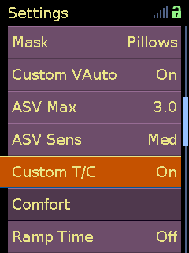

# Custom VAuto

The `stm32-plus.bin` build can replace the stock VAuto within-breath
pressure-support behavior with Custom VAuto.

The therapy mode remains VAuto. Stock VAuto continues to select EPAP using the
normal Min EPAP, Max IPAP, and PS settings. Custom VAuto changes how pressure
support is delivered during inspiration and expiration, and can add
breath-by-breath adaptive support.

This is separate from the stock ASV and ASVAuto modes. It does not use their
settings and does not add a timed backup rate.

- select VAuto on the device
- use the normal VAuto pressure settings
- enable Custom VAuto in the clinical Therapy menu
- expect reports to identify the session as VAuto

<p align="center">
  
</p>

## Operating states

| Configuration | Pressure behavior |
|---------------|-------------------|
| Custom VAuto Off | Complete stock VAuto pressure behavior |
| Custom VAuto On, ASV Max zero | Custom inspiratory and expiratory pressure shape without adaptive boost |
| Custom VAuto On, ASV Max above zero | Custom pressure shape with breath-by-breath adaptive boost |

VAuto PS set to zero bypasses the custom wrapper. The device continues to run
the stock VAuto controller with zero pressure support: EPAP remains under stock
VAuto control, while custom pressure shaping, adaptive boost, expiratory relief,
pre-trigger assist, and Custom T/C are disabled.

## Controls

| Setting | UART | Range | Default | Menu | Visible modes | Function | Without `custom_settings` |
|---------|------|-------|---------|------|---------------|----------|---------------------------|
| Custom VAuto | `RPO` | Off, On | Off | Therapy | VAuto | Selects stock VAuto or the complete custom pressure-support path | On |
| ASV Max | `RCM` | 0.0 to 10.0 cmH2O, step 0.2 | 3.0 cmH2O | Therapy | VAuto | Limits adaptive boost above the custom base pressure shape; zero disables adaptive boost | `2 * VAuto PS` |
| ASV Sens | `RXM` | Very Low, Low, Med, High, Very High | Med | Therapy | VAuto | Scales the adaptive controller response | Med |
| EPS | `RDH` | 0.0 to 3.0 cmH2O, step 0.2 | 0.0 cmH2O | Therapy | VAuto | Maximum exhale relief below EPAP; zero disables relief | 1.0 cmH2O |
| Custom T/C | `RPH` | Off, On | Off | Therapy | S, ST, VAuto, PAC | Uses custom multi-signal trigger and flow-shape cycle decisions | On where supported by the runtime path |

Firmware variable assignments and persistence are listed in the
[custom settings registry](../../custom_settings.md#assignments).

ASV Sens uses these controller multipliers:

| Setting | Multiplier |
|---------|------------|
| Very Low | 0.50 |
| Low | 0.75 |
| Med | 1.00 |
| High | 1.25 |
| Very High | 1.50 |

Ti Min remains a normal VAuto timing setting. It is not used as the Custom VAuto
enable switch.

## Therapy behavior

### Stock behavior retained

Custom VAuto uses the stock VAuto pressure phase as its input, replaces the
within-breath pressure-support calculation, then passes the result through the
stock final pressure limiter.

| Behavior | Stock VAuto | Custom VAuto |
|----------|-------------|--------------|
| EPAP | Selected by the stock VAuto controller | Unchanged |
| Configured PS | Defines the difference between EPAP and full inspiratory pressure | Defines the nominal support range used by the custom pressure shape |
| Inspiration | Stock VAuto pressure waveform | Custom base shape with optional adaptive boost |
| Expiration | Stock pressure return toward EPAP | Custom downslope with adjustable exhale relief |
| Trigger preparation | Stock response | May add up to 0.4 cmH2O of pre-trigger pressure assist |
| Trigger and cycle decisions | Configured stock thresholds | Stock thresholds or Custom T/C decisions |
| Final pressure | Limited by Max IPAP | Adaptive boost can exceed the selected Max IPAP; see Pressure limits |
| Backup rate | None | None |
| Reported mode | VAuto | VAuto |

### Base pressure-support shape

Let:

- `PS` be the configured VAuto pressure support
- `x` be the stock VAuto pressure phase from 0 to 1
- `e` be the current expiratory offset, at or below zero

The non-adaptive custom support shape is:

```text
base(x) = 0.45 + lerp(e, PS - 0.45, x)
```

At full inspiration, `base(1) = PS`. During the transition, the custom curve
connects the expiratory offset to the configured support. This base shape
remains active when ASV Max is zero.

### Adaptive boost

The adaptive controller builds a reference from fully observed inspirations,
without a fixed tidal-volume target. Each checkpoint starts with the average of
its first 20 measurements before it is used to adjust support. Subsequent
measurements update a two-stage moving reference. At roughly 50 ms checkpoints,
the controller compares cumulative inspired volume with the reference at the
same point in the breath:

```text
volume_ratio(t) = current_volume(t) / reference_volume(t)
```

A ratio between approximately `0.94` and `0.96` is treated as neutral. Lower
values request more support. Higher values reduce the adaptive contribution,
but never below the custom base shape.

| Current breath | Response |
|----------------|----------|
| Smaller than the recent reference | Increase adaptive pressure support |
| Close to the recent reference | Stay near the custom base pressure shape |
| Larger than the recent reference | Reduce adaptive boost |

The controller output is scaled by ASV Sens and gradually enabled at the start
of inspiration:

```text
adaptive_factor =
    clamp(1 + sensitivity * PID(volume_error) * startup_ramp, 1, 2.5)
```

The adaptive branch uses a steeper pressure-phase curve:

```text
q(x) = 0.75x + 0.25(1 - (1 - x)^4)
```

The adaptive factor blends or scales this curve. ASV Max then places a relative
limit on the resulting support:

```text
support(x) = min(adaptive_shape(x), base(x) + ASV Max)
```

ASV Max is not an absolute pressure setting. ASV Sens changes the strength of
the controller response rather than adding a fixed pressure amount.

The adaptive response is stabilized by:

| Behavior | Purpose |
|----------|---------|
| Two-stage moving reference | Limits how strongly one breath can change the reference curve |
| Early-inspiration limiting | Gradually enables the adaptive factor at the start of inspiration |
| Boost engagement limiting | Limits the first breaths when adaptive boost engages or re-engages |
| Post-large-breath dampening | Temporarily lowers the neutral comparison range after an unusually large breath |

### Expiration and pre-trigger assist

The largest support reached during inspiration is retained as the start of the
expiratory downslope. EPS sets the maximum exhale relief below EPAP; zero
disables relief. After an inspiration lasting at least 0.7 seconds, adaptive
boost reduces the initial relief:

```text
relief = max(0, EPS - 0.25 * max(0, peak_support - PS))
```

The relief fades with remaining integrated breath volume and with current and
recent expiratory timing. The expiratory phase is curved as follows:

```text
x_exp = 0.25x + 0.75x^2
support_exp = lerp(exhale_offset, peak_support, x_exp)
```

During expiration, the wrapper also projects flow approximately 80 ms ahead.
When the projected flow crosses the trigger threshold and current flow is
positive, it can add 0.2 or 0.4 cmH2O of support before the detected inspiration.

### Trigger and cycle

Custom T/C is available in S, ST, VAuto, and PAC. The EasyBreathe pressure
waveform does not use Custom T/C.

Custom trigger combines:

- current positive patient flow
- accumulated positive-flow volume
- pressure below the current target
- proximity to the recent typical breath timing

The custom score takes control when commanded pressure is stable or the
projected flow indicates a likely inspiration. A score at or above `1.0` requests
inspiration; a lower score holds expiration. At other times, the
configured stock trigger threshold remains in use.

Custom cycle compares leak-compensated flow with its peak during the same
inspiration. The configured Cycle setting supplies the stock fraction
`s`, from which the custom threshold is calculated:

```text
custom_cycle_fraction = 0.5s - 0.225
```

Expiration is requested when flow falls below that custom fraction of peak
flow, or when a low-flow counter reaches 600 ms. The counter counts up while
flow is below the configured Cycle fraction of peak flow, and down otherwise.

Custom T/C cannot shorten inspiration below Ti Min or bypass the minimum
expiratory time. Ti Max still ends inspiration, and modes with timed backup
can still start a breath without a patient trigger. Before another patient
trigger can be accepted, flow must fall below the configured Trigger threshold.

With Custom T/C Off, triggering and cycling use the configured stock
sensitivities.

### Pressure limits

Exhale relief cannot lower the base pressure target below 4 cmH2O. If the stock
target is already lower during a transition, Custom VAuto does not lower it
further.

Max IPAP limits the stock VAuto baseline. Adaptive support is added afterwards
and can raise inspiratory pressure above the selected Max IPAP. ASV Max limits
this addition relative to the custom base shape, not absolute IPAP.

The stock final limiter uses the upper allowed bound of the Max IPAP setting,
not the value selected in the menu.

## Backup rate

Custom VAuto does not provide timed backup breaths. Control of the stock ASV
and ASVAuto backup response is a separate
[ASV backup-rate feature](asv_backup_rate.md).

## Caveats

- Large leaks or unstable triggering can distort flow and volume tracking.
- ASV and ASVAuto settings do not control Custom VAuto.
