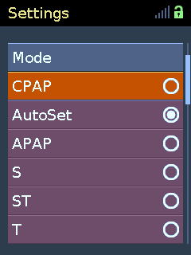
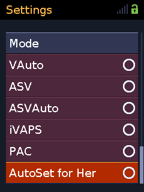
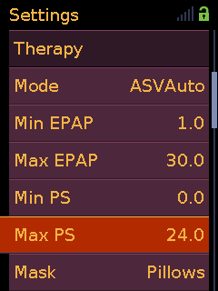

# General Features

These features expand the modes, settings, recording, and hardware options
available on supported AirSense 10 and AirCurve 10 firmware. They are included
in the standard patched images unless noted otherwise.

## All Therapy Modes

AirSense 10 and AirCurve 10 variants from the same firmware generation share
the underlying therapy implementations. 
The device-specific configuration
normally limits the mode selector to the modes sold with a particular model.
The patch removes that restriction, exposing CPAP, AutoSet, APAP, S, ST, T,
VAuto, ASV, ASVAuto, iVAPS, PAC, and AutoSet for Her.

  
  

This patch changes only mode availability. It does not expose the related
clinical settings; that is handled by the clinical settings patch below.
It also leaves the model's original EDF signal selection unchanged. Full recording
for the additional modes requires the EDF merge patch.

## Clinical Settings and Pressure Range

The clinical menu exposes the settings associated with the unlocked therapy
modes, including mode-specific pressure, timing, trigger, cycle, and comfort
controls.
The menu continues to show only settings relevant to the currently
selected mode.

Standard pressure controls are expanded to the full 1.0 to 30.0 cmH2O range.

  

## Fall Time

This optional patch adjusts the stock pressure transition from IPAP to EPAP
in S, ST, T, PAC, and iVAPS. Longer times make the pressure fall more gradually.
S/ST/T/PAC use a linear fall; iVAPS retains its curved pressure transition.
In S, turn Easy-Breathe Off to use Fall Time.

With custom settings, clinical **Therapy** contains:

| Setting | UART | Values | Default |
|---------|------|--------|---------|
| Fall Time | RCW | 100-900 ms, step 50 ms | 100 ms |

Without custom settings, the stock fall remains unchanged.
In S/ST/T/PAC, [Square Wave](squarewave.md) supplies its own pressure
waveform; turn it Off to use Fall Time.

## ST iBR

This optional patch adds adaptive backup timing in ST. With **iBR Off**, the
existing **Backup Rate** (`RRT`) sets the fixed backup frequency. With **iBR On**,
the same setting supplies the target rate for adaptive backup.

After a spontaneous breath, the machine allows up to 1.5 times the target breath
period before delivering a timed breath. Successive timed breaths shorten this
period toward the target: approximately 1.5, 1.375, 1.25, 1.125, then 1 times the
target period. A spontaneous trigger restarts this sequence.

With custom settings, clinical **Therapy** contains:

| Setting | UART | Values | Default |
|---------|------|--------|---------|
| iBR | RXW | Off, On | Off |

Without custom settings, ST retains its stock fixed backup rate.

## iVAPS AutoEPAP

This optional patch adds Lumis-style automatic EPAP adjustment to iVAPS.
It raises EPAP in response to inspiratory flow shape and sustained
reductions in flow, then gradually lowers it when those responses subside.
The existing iVAPS controller continues to adjust pressure support toward
Target Va.

With custom settings, clinical **Therapy** contains:

| Setting | UART | Values | Default |
|---------|------|--------|---------|
| AutoEPAP | RSA | Off, On | Off |
| Min EPAP | RDF | iVAPS EPAP range, step 0.2 cmH2O | 5.0 cmH2O |
| Max EPAP | RDM | iVAPS EPAP range, step 0.2 cmH2O | 15.0 cmH2O |

With AutoEPAP On, Min/Max EPAP replace the fixed EPAP setting in the menu.
If Fall Time is installed, flow-shape analysis uses its selected duration.

## Target Humidity

This patch lets users adjust humidification above or below the stock
85% relative humidity target, in both Auto and Manual Climate Control.
Lower targets reduce the requested moisture; higher targets increase it.
Manual humidity levels remain available and work alongside this setting.

With custom settings, **Target RH (%)** appears in clinical **Accessories**:
70-100%, in steps of 1 percentage point. The setting is saved across restarts
and is also available over UART as `RCH`. The default is 85%, unless a different
value is selected when building the image.

Without custom settings, the target stays at the value selected when building.
Without this patch, the stock 85% target remains unchanged.

The percentage is a target, not a measurement of humidity at the mask.
Higher targets increase condensation risk; 100% targets saturation.

## Header Clock

Enable **Clock** in clinical **Configuration** to replace the Home and active
therapy-screen titles with the device time in 24-hour `HH:MM` format.

## Motor Runtime Warning

The patch removes the "Motor life exceeded" nag screen that stock firmware can
show after roughly 20,000 blower runtime hours.

Only the warning screen is removed. The device still tracks and reports its
actual runtime hours,
and no therapy records, service information, or usage data are erased.

## EDF Recording

Stock Air10 variants and therapy modes record different subsets of the
available EDF data. The patch enables a common recording superset so switching
therapy mode does not remove data that the firmware is able to record.

The files remain standard EDF files on the SD card. Signals not used or
produced by the active therapy mode or connected hardware may remain empty or
zero, and the additional channels can make the files slightly larger.

## myAir Cloud Compatibility

myAir accepts sessions only when the selected therapy mode is supported by the
reported device model. Using a mode unlocked from another AirSense or AirCurve
variant can otherwise cause cloud reporting to be rejected.

The patch keeps the reported model compatible with the selected therapy mode
while preserving the device serial number and existing cloud provisioning.

## Replacement LCD Driver

An optional universal LCD driver supports ILI9325 and ILI9328 panels, which are
among the most readily available replacement displays for these devices. This
allows a compatible replacement panel to be used when the original display is
damaged or unavailable.

The controller is detected at startup. Devices with the original ILI9341 panel
continue to use the stock display path, so the same patched image can support
both the original and replacement controllers. Enable this driver when
building with `PATCH_S10_LCD=1`.
